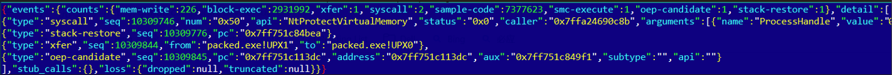
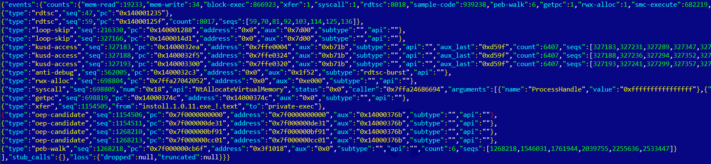
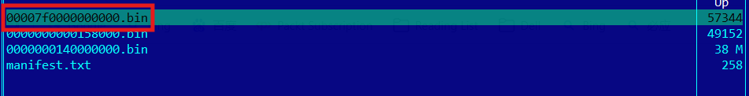

# Sheller

A Unicorn-based Windows user-mode emulation engine focused on PE unpacking,
shellcode extraction, and pre-payload behavior fingerprinting, running on both
Windows and Linux. Samples execute inside a controlled emulator: zero escape,
deterministic replay, and instruction-level visibility.

**If you use Sheller to analyze untrusted code, run it at your own risk.** By
design the sample should never execute its own instructions natively -
capture spawns it suspended and patched, analysis runs in emulated user mode
(details in *Safety: where samples execute* below) - but no isolation rules out
escape entirely: treat the host accordingly and use a virtual machine whenever
the sample worries you.

## Usage

Three commands cover the normal loop: snapshot a sample, replay it under
instruction-level visibility, or take one sample straight to a repaired image.

```bash
sheller capture sample.exe -o sample.snap          # Windows host; --shellcode for a blob

sheller run sample.snap --from-snapshot \
        --report report.json --dump out/ \
        --budget 200M                              # bounded run

sheller run sample.snap --from-snapshot --stop xfer=1 \
        --dump oep/                                # stop before the first transfer

sheller run sample.snap --from-snapshot --stop esp \
        -b 0M --dump oep/                          # stop at the entry stack restore

sheller unpack packed.exe                          # -> packed.exe.unp

sheller unpack packed.exe --stop esp+xfer \
        -o packed_oep.exe                          # dump at the payload boundary, entry stamped
```

`report.json` is the event artifact: one `events` object whose `detail` is a single
whole-run-ordered list of raw events and judgment events (module walks, clock probes,
SMC crossings, ...), plus exact whole-run `counts`, the `stub_calls` side table and
`loss`. The default level lists the semantic types, sample-code page reads/writes
into system DLLs and low-frequency judgments; `--event-level full` adds the
window-side types (`block-exec`, `sample-code`, `smc-execute`) from the bounded
ledger window and turns `loss` into counters. The same input replays to a
byte-identical file, which is what lets the baselines in `tests/goldens/` pin the
stream. `out/` holds one raw `.bin` per region the guest wrote plus `manifest.txt`,
and `sheller unpack` feeds those regions into IAT repair, landing `packed.exe.unp`
plus one report (`--report`, default `packed.exe.unp.report.json`) and a one-line
repair verdict summary; the per-region conclusions are also structured in the
returned `UnpackOutcome`, not a report file.

`--stop xfer=<n>` stops before the landing block of the Nth execution transfer
(1-based; 0 = off) as a successful stop: the dump and report are written and the
exit code stays 0. It competes with `-b/--budget` and `--timeout-ms` by arrival,
and a wall clock crossed inside the leg the transfer ends does not turn it into a
timeout; a miss is one hint line, naming the limit that arrived first when one
did. The same option also carries the ESP-law targets `esp` (stop at the
confirmed entry stack restore) and `esp+xfer` (arm on it, stop at the next
transfer). On `unpack`, `esp+xfer` is the target that restores the entry point:
the delivery transfer fires the OEP candidate the repair stamps into the
written image, while bare `esp` stops before the payload jump - the image is
dumped and its imports repaired, but the entry point stays the stub's (the OEP
is never observed). Targets never lift the limit defaults (`run` 3M instructions / 10s,
`unpack`'s wall clock alone) - pass an explicit budget when the goal lies beyond
their reach. The confirmed restore itself is a passive `stack-restore` event in
every instrumented run - the stop is only ever the goal's.

Exception for DLL inputs: UPX-class DllMain stubs open their entry with
argument-shadow stores and a reason branch before the register saves, so the
esp scan finds no contiguous push sequence there and `esp` / `esp+xfer` are a
documented silent miss - the run closes normally and the unpack still
completes. The usable stop face on a packed DLL is `--stop xfer=1`: the
stub's post-restore jump to the unpacked entry is the first counted transfer,
which is the OEP dump stop (see docs/cli.md, "Stop targets").

## Example runs

The packed.exe corpus unpacked with `--stop esp+xfer`: the report's counts line
and the tail of its `detail` list - the delivery transfer
(`packed.exe!UPX1` to `packed.exe!UPX0`), the OEP candidate the repair stamps
as the entry point, and the passive stack-restore.



A real-world run: a SilverFox trojan downloader (MD5
`9b512d80f5137772ce610b60f952f0d5`). The report carries rdtsc-burst anti-debug,
an RWX allocation, the hand-off from the sample into the private-exec region
(`oep-candidate` x4) and the stage-2 `peb-walk`.



The same run's dump directory: the highlighted 57,344-byte region is the RWX
allocation holding the delivered shellcode.



## Hosts and execution

A sample can run without a capture host: on Linux the engine constructs a v1
container from the PE bytes plus the synthetic system modules, then replays that
container through the same snapshot pipeline. `sheller unpack` and `analyze`
therefore carry the full behavior tier and module attribution there, and the
repair verdict matches the capture route (`complete` on the packed corpus).
The sample route needs the generated `synth_modules` directory next to the CLI
(the build produces it; the CLI locates it automatically). PE32 sample input is
refused on these hosts with a named capture-class failure instead of entering
the 32-bit path.

Inside the emulator the guest is treated as a real Windows process: syscalls answer
from a data-driven policy table with ntdll numbers resolved from the guest's own
image, catchable exceptions walk the guest's SEH and C++ EH tables, and extra guest
threads turn under a cooperative scheduler - x64 and WoW64 alike. Guest time never
reads the wall clock (instruction-counted KUSER_SHARED_DATA ticks and RDTSC), so
delay loops and spin counters cost emulation time only; a decoder-free
fast-forward collapses pure-counter spins, and a loop-native-gate ledger (a Zydis
closed-CFG scan over probe windows) records which hot loops would ever qualify for
host-CPU execution - `SHELLER_LOOP_GATE_TRACE=1` with `--log-level debug` prints
that audit.

## Input support: bitness, DLLs, shellcode

* **64-bit PE (x64)** - the mainline: captured on Windows, reconstructed into a
  container on Linux.
* **32-bit PE (PE32)** - supported on Windows through the real WOW64 loader:
  the capture reads the 32-bit PEB/TEB and the replay runs in 32-bit guest
  mode. The Linux sample route refuses PE32 with a named failure (32-bit
  container replay is a tracked backlog item).
* **DLLs** - supported as x64 direct input on Windows (and for replaying
  an already-captured v2 container anywhere): the capture spawns a
  generated load-stub runner - base imports `kernel32!LoadLibraryW` and
  `ExitProcess`, plus one import per verified system dependency so they
  initialize normally under the real loader - and the sample bytes travel
  beside the snapshot as a pending module; the load happens inside the
  emulator - synthetic map, relocations, IAT resolution, Ldr entry, TLS
  callbacks, DllMain `DLL_PROCESS_ATTACH` - so the sample never executes
  in a real process. One sample DLL per run; dependencies are admitted
  by system-source verification (including `user32` - a same-named file
  outside the system directory does not pass), and private, path-shaped,
  or missing dependencies are rejected by name before any process
  exists. Unpack on a packed DLL reproduces the reference entry point
  and rebuilt imports (`tests/packed.dll` vs `tests/packed.dll.unp`).
  Replaying one fixed container is a pure function of its bytes: two
  independent processes produce byte-identical reports, raw event streams,
  dumps and repaired `.unp` images (pinned cross-process in
  `dll_e2e`/`dll_capture_e2e`; two separate *captures* still drift by
  design - the live loader world is not a deterministic input).
* **Shellcode blobs** - `--shellcode` embeds the blob in a generated minimal
  wrapper PE (x64 and x86) and rides the capture route.

Embedding the library instead of driving the CLI - six exported entries, an install
prefix consumed with `find_package(sheller CONFIG)` - is [docs/embedding.md](docs/embedding.md);
flag by flag, both event levels and the trace switches are [docs/cli.md](docs/cli.md).

## Safety: where samples execute

On Windows the pipeline touches the sample file in two places, with different
isolation:

* **`capture` spawns the sample as a real process, and the sample executes zero
  instructions of its own there.** It is created suspended
  (`CREATE_SUSPENDED`), its entry point is patched into an in-place spin
  (`EB FE`) and its TLS callback array - the other auto-run entry a PE has -
  is zeroed before the process is resumed; the resume only lets the Windows
  loader finish and the main thread spin at the entry. The photographer reads
  registers, TEB and every committed region, then the process is terminated.
  `--shellcode` blobs ride the same route inside a generated minimal wrapper
  PE (one RX section, entry at its start).
* **`run`, `unpack` and `analyze` execute the guest only inside the unicorn
  user-mode emulator** (see the emulator paragraph above). Guest syscalls are
  answered by the engine's policy table (default deny); the guest has no
  access to the host's network, registry or filesystem - its `NtWriteFile`
  bytes reach the host only through `--guest-stdout`. What lands on your disk
  is sheller's own output: the snapshot, the report, the dump regions and the
  repaired image.

Two honest caveats. The capture process still maps the sample's image and runs
the Windows loader across it, so security software on the host may flag or
quarantine the sample file - a suspended process is not a containment
boundary. And sheller is a user-mode analysis tool, not a hardened sandbox
product: the isolation above is the designed, tested behavior, not an escape
guarantee. If the sample is hostile enough that you would rather not bet on
either, run sheller inside a virtual machine - the snapshot, report and dumps
all stay inside it.

## Build

Prerequisites: CMake >= 3.24, Ninja, MSVC 2022 / GCC 13+ / Clang 16+, `VCPKG_ROOT`.
The vcpkg manifest pulls unicorn, CLI11, xxHash and zydis.

```bash
cmake --preset windows-release      # or linux-release / linux-sanitizer
cmake --build --preset windows-release
ctest  --preset windows-release
```

A default build produces the static core (`sheller_engine`, `sheller_unpack`,
`sheller_capture`, `sheller_api`), the **shared interface library**
(`libsheller.so`; `sheller.dll` plus its import library on Windows), the `sheller`
CLI and the test binaries.

## Documentation

- [docs/cli.md](docs/cli.md) - the command line: `capture`, `run`, `unpack`, every
  flag, the report's two event levels and their shapes, the attribution and xfer
  conventions, and how determinism is held to.
- [docs/embedding.md](docs/embedding.md) - linking the library: what
  `cmake --install` delivers, the six exported entries, diagnostics, events, guest
  output, lifetime, concurrency, and the toolchain contract. The normative text for
  what crosses the boundary is `include/sheller/export.h`.
- [tests/README.md](tests/README.md) - the test map: suites and what each holds,
  fixtures, golden baselines, sanitizer presets, and the local Linux verification
  gates.
- [CONTRIBUTING.md](CONTRIBUTING.md) - one-command build, dependency policy, code
  style as CI enforces it, commit rules, and the repository layout.

## License

GPL-2.0-only - the same license as [unicorn](https://github.com/unicorn-engine/unicorn).
See [LICENSE](LICENSE).
